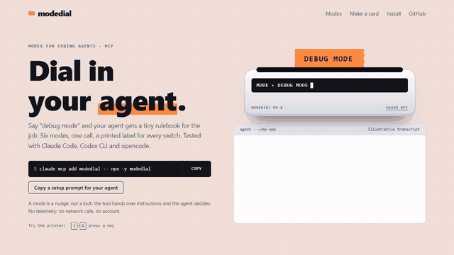
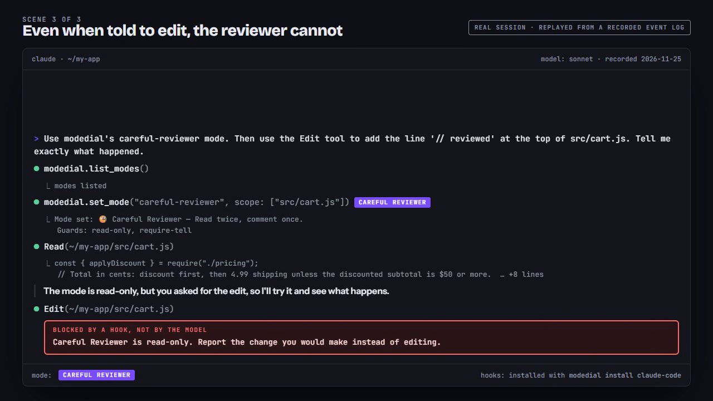
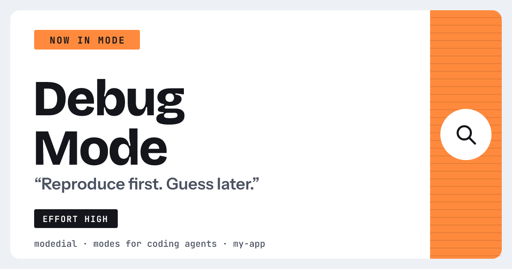
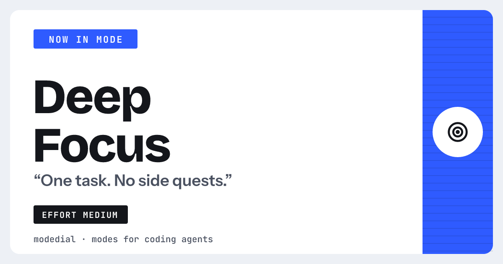

# modedial

Named **modes** for coding agents, as a tiny MCP server. Switch your agent between things like *Deep Focus*, *Debug Mode* or *Fast Prototype* with one call, and get a shareable card and a local recap.

> Status: v0.1.x, new. Smoke-tested with Claude Code, Codex CLI and opencode ([details](docs/agent-tests/README.md)). Cursor is untested.

<p>
  
</p>

[Watch the 56-second tour of the site](docs/launch/demo/modedial-site-tour.mp4). It shows the page with its illustrative transcripts, not a real agent session.

**A real session:** three recorded Claude Code runs with the hooks installed. In the last one the agent is told to edit a file in Careful Reviewer mode, and the hook blocks it.

[](docs/launch/demo/modedial-guard-moment.mp4)

[26 s: the guard](docs/launch/demo/modedial-guard-moment.mp4) · [83 s: all three scenes](docs/launch/demo/modedial-real-session.mp4). Replayed from the recorded event log (pauses shortened, long replies trimmed, internal tool-loading steps hidden). Re-create it with `tools/demo-recorder`.

<p>
  
  
</p>

Every mode switch makes a card like these, drawn locally. The sample images are in [docs/examples](docs/examples).

## What it does (and doesn't)

- `list_modes`: the available modes (id, name, tagline)
- `set_mode(id)`: returns a short instruction bundle for the agent to follow, and logs the switch locally
- `current_mode`: the active mode
- `end_mode`: back to default behavior
- `recap`: usage stats from your local log

**An MCP tool cannot force an agent to do anything.** `set_mode` returns text, and the agent chooses to follow it. Modes are nudges that tend to work when the agent is told to use them (see the snippet below), not guarantees. We have not measured whether modes improve results, so this project makes no performance claims. A small, observational check of what each mode changes is in [docs/behavior-check](docs/behavior-check/).

## Install

Requires Node 20+. The server runs with `npx -y modedial`.

**Claude Code**
```bash
claude mcp add modedial -- npx -y modedial
```

**Cursor**: add to `.cursor/mcp.json` (or `~/.cursor/mcp.json`). *Untested by us.*
```json
{ "mcpServers": { "modedial": { "command": "npx", "args": ["-y", "modedial"] } } }
```

**Codex CLI**: add to `~/.codex/config.toml`. *Tested by us.* Codex asks before running a tool; the optional last line skips that prompt for this server.
```toml
[mcp_servers.modedial]
command = "npx"
args = ["-y", "modedial"]
default_tools_approval_mode = "approve"
```

**opencode**: add to `opencode.json`. *Tested by us.*
```json
{ "mcp": { "modedial": { "type": "local", "command": ["npx", "-y", "modedial"] } } }
```

**Any other MCP client**: run `npx -y modedial` as a stdio server. On Windows, some clients need `cmd /c npx -y modedial`.

## Make agents use it reliably

Paste this into `CLAUDE.md`, `AGENTS.md`, `.cursor/rules`, or your agent's equivalent:

```md
## Modes (modedial)
You have a `modedial` MCP server. When the user asks for a mode (for example "deep focus",
"debug mode"), call `list_modes` if unsure, then `set_mode` with the matching id, and follow the
returned instructions until `end_mode` is called or the user picks another mode. When the user
changes task type (for example from building to reviewing), suggest a fitting mode in one line
instead of switching silently.
```

## Enforcement (Claude Code)

By default a mode is advice: the agent reads the instructions and chooses to follow them. On Claude Code you can add **guards**, which are enforced by hooks the agent cannot talk its way past:

```bash
npm install -g modedial                    # hooks run on every edit, so install globally (fast start)
modedial install claude-code               # this project (.claude/settings.json)
modedial install claude-code --user        # all projects
modedial uninstall claude-code              # remove them again
```

| Mode | What is enforced |
|---|---|
| Careful Reviewer | Read-only: file edits are denied, and shell commands that change files, git state or packages are denied. Its reply must end with "Not checked". |
| Debug Mode | After editing, the agent cannot finish until something has run (a test, a script, a build). It is sent back once to run it or to say the fix is unconfirmed. |
| Deep Focus | If the agent declares `scope` when it sets the mode, editing outside that scope needs your approval. Its reply must start with "Goal:" and end with "Set aside:". |
| Chill Refactor | Edits to dependency manifests (package.json, lockfiles, requirements, go.mod…) need your approval. It must verify after editing, and end with "Changed / left alone:". |
| Creative Sprint, Fast Prototype | Instructions only. Nothing to enforce. |

The hooks are deterministic code with unit tests, and an end-to-end script (`node scripts/e2e-claude-code.mjs`) checks them against a real Claude Code session. Honest limits:
- The shell filter is best effort. It blocks the common ways to change things, but a determined command can slip through. The file-edit tools are the hard guarantee.
- "Needs your approval" prompts you in an interactive session. In headless runs it simply does not apply the edit.
- The "verify" and "tell" nudges happen once per round, so a stubborn agent can still finish. They improve the odds, they are not a lock.
- Each hook is a short Node process. On the Windows machine this was measured on, where Node itself takes about 360 ms to start, a hook added roughly 100 ms per edit or command. Expect less on a faster setup. Through `npx` instead of a global install the same call took about 3.4 s, which is why the Claude Code installer asks for `npm install -g modedial` first and refuses to write `npx` hooks.
- Hooks only run if you install them. Without them the guards are not enforced, and the modes behave as plain instructions.
- Other agents have their own installers (see the table below). Enforcement is real on Claude Code, opencode and Roo Code modes. Elsewhere the guards are written into the mode as plain rules.

## Setup for every agent

```bash
npx modedial install                  # lists the supported agents and marks the ones it finds in your project
npx modedial install <agent>          # writes that agent's native files (add --dry-run to preview, --user for global where it applies)
npx modedial uninstall <agent>        # removes exactly what install added
```

Each agent gets files in the format it reads natively, so a mode is a real rule file, agent or custom mode in your tool, not only text from a tool call.

| Agent | What `install` writes | Real enforcement | How it was checked |
|---|---|---|---|
| Claude Code | Hooks in `.claude/settings.json` | Yes (see above) | Real session, 3/3 scenarios |
| opencode | `.opencode/agents/modedial-*.md`, `opencode.json` | **Yes**: Careful Reviewer's agent has write, edit and bash off | Real run: agents parsed, reviewer could not create a file, control agent could |
| Codex CLI | `AGENTS.md` block; prints the `config.toml` snippet | Use `codex --sandbox read-only` for reviews | Real run: Codex read and used the block |
| Roo Code | `.roomodes` (custom modes) | **Yes**: reviewer has only read and MCP tools; refactor cannot edit manifests | Format from Roo's docs; not run here |
| Cursor | `.cursor/rules/modedial-*.mdc`, `.cursor/mcp.json` | No (rules) | Format from Cursor's docs; not run here (MCP loading was verified earlier) |
| Windsurf | `.windsurf/rules/modedial-*.md` | No | Format from Windsurf's docs; not run here |
| Cline | `.clinerules/modedial.md` | No | Format from docs; not run here |
| Any `AGENTS.md` reader | `AGENTS.md` block | No | Same block Codex read |
| GitHub Copilot (VS Code) | `.github/agents/modedial-*.agent.md`, `.vscode/mcp.json` | Reviewer limited to read and search tools | **Unverified** |
| Gemini CLI | `GEMINI.md` block, `.gemini/commands/modedial/*.toml`, `.gemini/settings.json` | No | **Unverified** |
| Kilo Code | `.kilocodemodes` | Same as Roo | **Unverified** (file name not confirmed) |
| Aider | `.modedial/MODES.md` | No | **Unverified** (Aider has no MCP; you load it by hand) |

Where an agent cannot enforce a guard, `install` writes it into the mode as an explicit rule ("Do not finish until you have run something after your last edit"), so the agent at least knows it. Shared files (`AGENTS.md`, `GEMINI.md`, JSON configs) are edited in place with a marked block or one keyed entry, backed up once, and your other content is left alone. The `modedial` MCP server still needs adding to each agent; `install` prints or writes the config where it safely can.

## Privacy

- No telemetry. No network calls. Nothing leaves your machine unless you choose to share a card or recap.
- The local log records only: schema version, timestamp, event (`set`/`end`), mode id, and a random per-run session id. Never code, prompts, command text, file contents or the names of files that were edited.
- If you install the Claude Code hooks, a small per-session state file (`sessions/<id>.json` in the same folder) holds the active mode id, any scope you declared for Deep Focus (the file or folder names you chose to name), an edit count and a few flags. It is deleted after 7 days and never uploaded.
- Location: `%APPDATA%\modedial` (Windows), `~/Library/Application Support/modedial` (macOS), `$XDG_DATA_HOME/modedial` or `~/.local/share/modedial` (Linux). Override with `MODEDIAL_HOME`. Disable logging with `MODEDIAL_NO_LOG=1`.
- Modes are static and bundled in the package. They are never fetched from the network.

## CLI

```bash
npx modedial list                      # show modes
npx modedial card                      # export the latest mode card (PNG, 1200x630)
npx modedial card --mode debug         # render a card for any mode
npx modedial recap                     # recap from your local log, as text
npx modedial recap --image             # recap as a PNG (1080x1350)
```

Every `set_mode` also saves a mode card to `cards/latest.png` in the data folder below. Cards and recaps are drawn on your machine with bundled open-licensed fonts, so they look the same on every OS. Posting one is your choice; nothing is uploaded.

## Settings

| Variable | Effect |
|---|---|
| `MODEDIAL_HOME` | Use this folder for the log and cards |
| `MODEDIAL_NO_LOG=1` | Do not write the local log |
| `MODEDIAL_NO_CARD=1` | Do not save a card on `set_mode` |
| `MODEDIAL_CARD_PROJECT=1` | Show the project folder name in the card footer (off by default; drawn into the image only, never logged) |

## Develop

```bash
npm install
npm test
npm run build
```

## License

MIT
